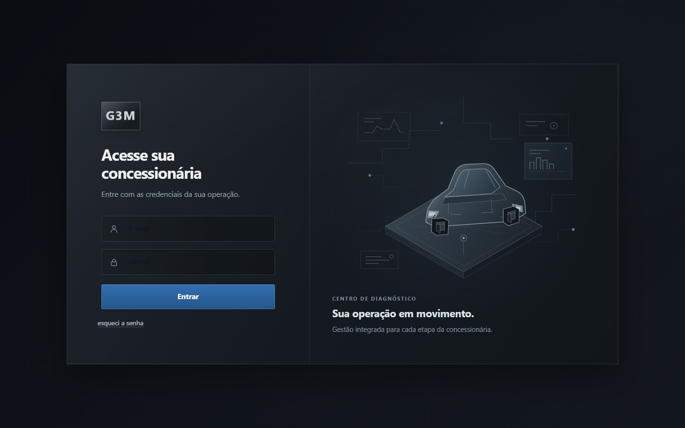
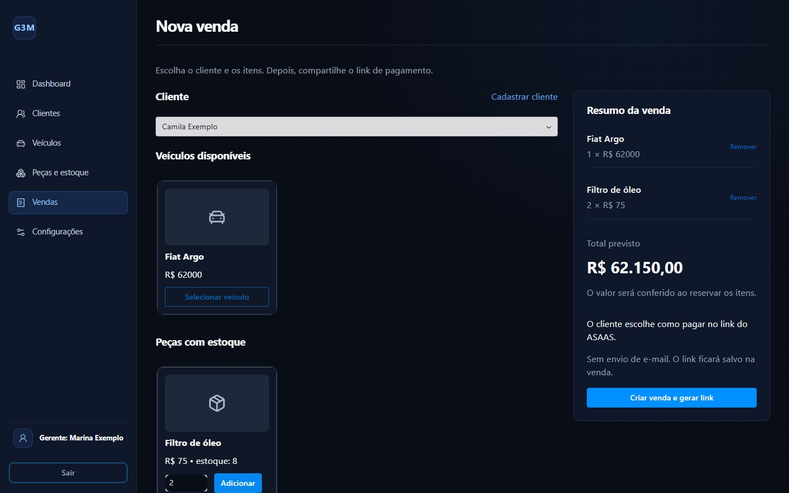
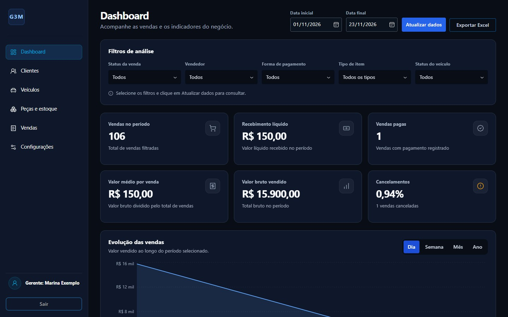

# G3M — AutoGestão

O G3M é um aplicativo web interno para concessionárias. Ele reúne o cadastro de clientes, o estoque de veículos e peças, o registro de vendas e o acompanhamento de recebimentos. Vendedores usam o sistema para montar vendas e compartilhar links de pagamento. Gerentes e administradores acompanham a equipe, o estoque e os indicadores do negócio.

## Acesso ao aplicativo

O [repositório do projeto no GitHub](https://github.com/AndrewPagani/openspec-G3M) é privado e exige acesso concedido pelo responsável. Em 23/11/2026, o repositório não informava endereço de uma versão web publicada. Para avaliação ou desenvolvimento, siga as instruções em [Executar localmente](#executar-localmente).

Para entrar no aplicativo, use o e-mail e a senha da conta fornecida pela empresa. A opção **Esqueci a senha** orienta a solicitar a redefinição ao administrador. Após entrar, o sistema abre o **Dashboard**. Use **Sair** ao terminar, especialmente em um computador compartilhado.



## Perfis de usuários

| Perfil | Acesso no aplicativo |
| --- | --- |
| **Vendedor** | Consulta clientes, veículos e peças. Cadastra clientes, opera suas próprias vendas e recupera seus links de pagamento. O Dashboard e a aba Vendas do Excel respeitam esse escopo. |
| **Gerente** | Acompanha as vendas da equipe, usa os filtros gerenciais do Dashboard, cadastra veículos, consulta o estoque e personaliza o painel. Pode excluir clientes e registrar recebimentos de parcelas elegíveis do histórico anterior ao ASAAS. |
| **Administrador** | Acompanha as vendas de toda a equipe e usa o Dashboard, o estoque, o cadastro de veículos e as configurações gerenciais. Tem acesso à área **Usuários** e à aba **Usuários** no Excel. |

Os três perfis podem cadastrar clientes e criar vendas. A tabela resume as ações principais. O Xano verifica o acesso em cada operação, inclusive quando um endereço é aberto diretamente.

## Funcionalidades e manual de uso

### 1. Encontrar ou cadastrar um cliente

1. Abra **Clientes** pelo menu. Pesquise por nome, CPF, telefone ou e-mail para conferir se já existe um cadastro.
2. Para consultar um registro, abra **Opções do cliente** na linha correspondente e selecione **Visualizar detalhes**. Use **Editar cliente** para atualizar os dados cadastrais.
3. Se for um novo cadastro, clique em **Novo Cliente**, preencha nome, CPF, telefone e e-mail e clique em **Salvar**.
4. Após a confirmação, localize o cliente na lista ou no seletor de **Nova venda**. Quando a integração está disponível, o cadastro cria ou recupera o vínculo com o ASAAS. Se houver erro durante a sincronização, confira o cadastro existente antes de tentar novamente.

Gerentes e administradores podem usar **Excluir perfil** no menu do cliente. Essa ação remove o cadastro e preserva as vendas no histórico, que podem passar a aparecer sem o nome do cliente.

### 2. Consultar estoque e cadastrar itens

- **Veículos**. Pesquise por modelo, marca ou placa e abra os detalhes do cartão para ver identificação, situação e especificações cadastradas.
- **Peças e estoque**. Busque pelo nome da peça e confira preço, área e saldo disponível. Use a ação **Editar** no cartão para atualizar os dados cadastrais disponíveis.
- **Cadastrar veículo**. Como gerente ou administrador, abra **Veículos → Novo**. Preencha marca, modelo, cor, ano e os dados solicitados, selecione o status e clique em **Salvar Veículo**. A URL da imagem é opcional. A confirmação indica que o veículo foi salvo.
- **Cadastrar peça**. Abra **Peças e estoque → Novo**. Preencha nome, preço, quantidade inicial e área, quando aplicável, e clique em **Salvar Peça**. Depois de salvar, confira o cartão e o saldo na listagem.

As listas de clientes e estoque carregam por etapas. Se uma busca mostrar resultados parciais, aguarde o carregamento ou use **Atualizar lista** após uma falha.

### 3. Criar uma venda e compartilhar o link

1. Abra **Vendas → Criar venda**.
2. Selecione o cliente. Se ele ainda não estiver cadastrado, use **Cadastrar cliente** e retorne à criação da venda.
3. Em **Veículos disponíveis**, clique em **Selecionar veículo** no cartão desejado. Em **Peças com estoque**, informe a quantidade e clique em **Adicionar**. É possível montar uma venda só de veículos, só de peças ou com itens das duas áreas.
4. Confira os itens e o **Total previsto** no resumo. Use **Remover** se precisar corrigir a seleção.
5. Clique em **Criar venda e gerar link**. O sistema confere o valor e a disponibilidade no Xano, registra a venda, reserva os itens e solicita a fatura ao ASAAS.
6. Use **Copiar link** para compartilhar a fatura com o cliente pelo canal de atendimento da empresa. O cliente escolhe o meio de pagamento na fatura. O link fica salvo na venda e o fluxo não envia e-mail.



### 4. Acompanhar a cobrança e recuperar o link

1. Em **Vendas**, informe o ID da venda, o nome ou o CPF do cliente e clique em **Filtrar**. A tela também oferece filtros por data e forma de pagamento. O vendedor vê apenas suas próprias vendas.
2. Clique em **Ver pagamento** na linha da venda. Confira o status e o vencimento, quando informado. Use **Abrir link de pagamento** ou **Copiar link** para recuperar a fatura.
3. Depois que o cliente pagar, use **Atualizar pagamento** para consultar o status. O sistema registra o recebimento após confirmação do ASAAS. Enquanto estiver pendente, a venda continua aguardando pagamento.

Se a venda já tiver sido registrada e a geração do link falhar, use **Gerar ou recuperar link** na mesma venda. Se a criação ficou sem confirmação, clique em **Conferir vendas registradas** e procure a operação antes de cadastrar outra.

Para uma venda anterior à integração, **Ver pagamento** mostra o histórico de parcelas. Quando o botão estiver disponível para o gerente, selecione a **Forma realmente recebida** e use **Confirmar recebimento integral** somente após conferir o dinheiro efetivamente recebido. Esse registro fica nas parcelas do histórico.

### 5. Consultar o Dashboard e exportar Excel

1. Em **Dashboard**, escolha **Data inicial** e **Data final**. Gerentes e administradores também podem usar os filtros de status da venda, vendedor, forma de pagamento, tipo de item e status do veículo.
2. Clique em **Aplicar filtros**. Use **Atualizar dados** para consultar novamente o recorte atual. Confira os indicadores, a evolução das vendas e, se tiver acesso gerencial, o estoque e as peças de saldo baixo.
3. Clique em **Exportar Excel** depois de aplicar os filtros. Aguarde a geração do arquivo **.xlsx**. É possível navegar durante a exportação.
4. No arquivo, confira o período e o total de registros por aba. **Dashboard** reúne indicadores e séries em tabelas, inclusive widgets ocultos na personalização. **Vendas** segue o mesmo recorte de datas, status, vendedor e forma de pagamento. **Clientes**, **Veículos** e **Peças** incluem todas as páginas acessíveis. **Usuários** aparece somente para administradores.

O filtro de tipo de item afeta as séries de itens. O filtro de status do veículo afeta os indicadores correspondentes de estoque. O valor bruto acompanha a data da venda, e o recebimento líquido acompanha a data em que o pagamento foi recebido.



### 6. Personalizar o painel e consultar usuários

- **Gerente ou administrador**. Em **Configurações**, escolha o tema escuro, claro ou automático e ajuste nome de exibição, título do Dashboard, visibilidade e ordem dos widgets. Clique em **Salvar personalização** e volte ao Dashboard para conferir. **Restaurar padrões** recupera a apresentação inicial. As preferências ficam neste navegador, separadas por conta.
- **Administrador**. Abra **Usuários** para consultar as contas cadastradas e seus perfis. A operação sobre as contas depende dos recursos disponíveis no ambiente. Para solicitar criação de conta, alteração de perfil ou redefinição de senha, acione o responsável pela administração.

## Exemplos de utilização

Os nomes e valores abaixo e os dados das capturas são fictícios.

| Cenário | Ação | Resultado esperado |
| --- | --- | --- |
| Venda mista | Selecione Camila Exemplo, um Fiat Argo de R$ 62.000 e duas unidades de um filtro de óleo de R$ 75. | O total previsto é R$ 62.150,00. Com estoque disponível, a venda é reservada e pode gerar um link para o cliente. |
| Recuperação após falha do ASAAS | Abra novamente uma venda já registrada e clique em **Gerar ou recuperar link**. | A tentativa usa a mesma venda e mantém a reserva existente. |
| Fechamento do mês | No perfil gerente, selecione o primeiro e o último dia do mês, aplique os filtros e exporte. | A aba Vendas contém os registros do período acessíveis ao perfil. As abas de cadastros abrangem a coleção acessível independentemente das datas. |

## Limitações conhecidas

- **Cobranças e testes.** A integração ASAAS foi homologada em Sandbox. A disponibilidade de cobranças reais depende da configuração do ambiente. A interface não oferece estorno, cancelamento de venda ou confirmação de entrega. O recebimento manual se restringe ao histórico elegível anterior ao ASAAS.
- **Estoque e contas.** O cadastro inicial de estoque está disponível. A interface não oferece ajuste de saldo de peça já cadastrada, edição de veículo existente ou alteração manual de status de veículo. Cadastro público, gestão de permissões e recuperação automática de senha estão fora do fluxo oferecido.
- **Listagem de vendas.** A tela mostra at? 100 registros por consulta. Use as datas ou a busca para localizar vendas mais antigas. O Excel percorre todas as p?ginas do recorte aplicado no Dashboard.
- **Indicadores.** Conversão e giro de estoque estão indisponíveis. O **Valor médio por venda** do Dashboard usa valor bruto dividido pela quantidade de vendas. O período de vendas do relatório é aplicado em UTC.
- **Excel.** A exportação permite uma geração por sessão, com limite de 20.000 linhas por coleção ou série, 1 MB por arquivo e 90 segundos por tentativa. Uma falha impede o download parcial. A exportação deixa de fora Configurações e links de cobrança.
- **Escopo do produto.** O sistema destina-se à operação interna. Gestão de leads, oficina, operação multiunidade e tela de auditoria genérica estão fora da versão entregue.

## Executar localmente

A execução local requer Python 3.11 ou superior e acesso a um ambiente Xano autorizado. Abrir o app localmente não cria uma conta de demonstração. Para usar um backend próprio, defina `XANO_BASE_URL` com a URL raiz desse ambiente antes de iniciar o backend. O app usa os grupos de API definidos em [app/services/xano_client.py](app/services/xano_client.py).

No Windows, abra dois terminais na raiz do repositório. No primeiro, prepare o ambiente e inicie o backend:

```powershell
python -m venv .venv
.\.venv\Scripts\python.exe -m pip install -r requirements.txt
.\.venv\Scripts\reflex.exe run --env dev --backend-only --backend-port 8001
```

Depois que o backend iniciar, execute no segundo terminal:

```powershell
.\.venv\Scripts\reflex.exe run --env dev --frontend-only --frontend-port 3000
```

Abra [localhost:3000](http://localhost:3000) e entre com uma conta autorizada. Se as rotas retornarem **404** após recompilar, reinicie o frontend depois de confirmar que o backend está ativo. Para testes com dados sintéticos, use as fixtures em [tests/browser](tests/browser/) ou gere a massa com `python scripts/generate_xano_seed.py` em um ambiente de teste.

### Documentação de referência

- [Especificações vigentes](docs/openspec/specs/) e [histórico de changes](docs/openspec/changes/)
- [Contexto verificado do projeto](docs/contexto-projeto.md)
- [Fluxo de vendas com ASAAS](docs/openspec/specs/venda-com-fatura-asaas/spec.md) e [especificação da exportação Excel](docs/openspec/specs/exportacao-relatorio-excel/spec.md)
